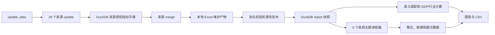

# UAE 代码审查与清理（2026-10-18）

前四轮内容为历史记录。当前审查范围、候选处置和验证依据以文末“2026-10-20 端到端复核”为准；早先“没有明确未处理项”的表述只代表当轮发现，不能作为已覆盖所有调用链和数据流的证据。

## 范围与方法

检查 `htfa/monitoring/uae/` 与 `htfa/jobs/uae_data/` 的全部 Python 模块：初始 44 个运行模块、42 个数据任务模块，约 3.1 万行；同时核对 28 个动态注册数据源、13 个 PowerShell 写表助手及 2 个批处理入口。

采用仓库级调用搜索、AST 导入/符号引用核对、入口签名检查和实际 DuckDB 页面运行验证。动态注册入口和有外部数据业务含义的历史格式解析，不能仅凭局部引用次数判定为死代码。

## 已处理的问题

| 问题 | 依据与处理 |
| --- | --- |
| 页面已移除的非油非金融图仍在计算 | 删除隐藏图组、计算函数和无消费者的指标映射。页面只计算配置中的 8 个图组。 |
| 分解表始终为空，仍保留通用绘图路径 | 删除空结果字段、分解条形图及通用折线回退；图表必须命中明确的绘图注册表，缺失配置直接报错。 |
| 未渲染的诊断叙事与置信度模板 | 页面只读取证据和限制说明，因此直接将它们保存在结果对象中；删除闲置诊断模板、无消费者的便利属性及包级重复导出。保留核算校验和实际来源记录。 |
| 旧指标别名可能改变统计口径 | 宏观石油产量仅映射“石油及其他液体”，不再使用“原油”别名替代。指标目录由 49 项缩减到实际使用的 39 项，每项只有一个规范名称。 |
| 残留图例前缀兼容 | 删除旧“真实/模拟”方括号标签清洗，直接使用规范数据列名。 |
| 17 个来源重复实现事务 | 集中到 `db.transaction`，显式提交/回滚，退出时不关闭共享连接；失败后连接仍能继续使用。 |
| 更新与合并重复维护来源清单 | 使用唯一 `source_registry.py`，统一 28 个来源及名称校验，拒绝空来源请求。 |
| 状态缺失默认成功 | 页面主题、数据更新和合并都要求明确状态。无效主题不影响其他主题；未知或缺失的更新/合并状态阻止发布。 |
| 旧任务分支与资源泄漏风险 | 删除不可能出现的“找不到合并来源”回退；元数据结果必须存在且成功；初始化或日志失败时也关闭拥有的数据库连接。 |
| 旧测试仍直接读 Excel | 修正油价任务集成测试，走“更新入库 → 合并工作簿 → 发布 DuckDB → 页面读取”，并禁止页面加载阶段调用 Excel I/O。 |
| 无消费者的常量 | 删除 DED 的 `DATASET_PAGE` 与 SCAD 的 `_INDICATOR_KEY`。 |

## 保留的必要行为

- DuckDB 发布版本检查、缓存隔离、只读页面加载以及 Excel 输入拒绝。
- 重复指标、频率、单位、来源、季度连续性、正数约束、行业加总及 FCSC 舍入误差校验。
- 下载、写表和发布失败时的回滚；现有有效数据、源文件和工作簿不因失败被替换。
- 各高频主题与图表之间的失败隔离。
- CBUAE 等官方历史格式的解析；它们用于读取真实历史文件，并非失败时替换数据源。
- 明确指定的 `--skip-download` 缓存重放、有限重试，以及工作簿已验证为最新时的 `skipped` 合并结果；更新失败不会自动改为缓存成功。
- 首轮审查时仍由 Python 来源任务调用的 13 个 PowerShell 写表助手；第三轮进一步将其中 8 份同构实现合并，见下文。

## 验证结果

- 清理前后按实际发布版本逐表比较：8 个可见图组完全一致；证据和限制说明一致。删除的唯一图组原本不被页面渲染。
- 数据库发布版本保持 `c7656533b9070cd957bbef3268d538d87b78098444947f8863b3675d58d2fbc8`，未修改生产数据文件。
- 在禁止 `pandas.ExcelFile`、`pandas.read_excel`、`openpyxl.load_workbook` 等页面 Excel I/O 的条件下：宏观 4 图、行业 4 图、高频默认 26 图、扩展 32 图均正常，共 40 张不同图表。
- UAE 分析、主题隔离及任务入口首轮回归 188 项通过；最终服务/入口/合并相关调整分别经 29 项和 42 项针对性回归通过。
- 提交前再次联合运行任务入口、自动更新、工作簿归属、来源修复、宏观服务和主题隔离测试，57 项全部通过。
- 27 个来源/发布测试文件首轮 230 项通过，发现 1 项过时 Excel 调用；修正后该文件 3 项全部通过。
- 共享 UI、普通表格和 Ts 运行时测试 77 项通过。
- 28 个注册来源的 `update` / `merge` 入口签名检查通过；静态扫描未留下未解决的导入、顶层符号或常量引用候选。

## 工程原则与边界

这次清理减少实际无消费者的功能和重复实现，没有新增插件框架、兼容层或通用调度层。数据获取、表源适配、核算计算、图表和 Streamlit 组合保持各自边界；共享事务和注册表由现有多个调用方使用。

上述结论针对当前仓库和离线回归所覆盖的流程。没有运行生产联网抓取或重写真实数据文件；这次审查不替代对外部数据接口实时可用性、数据发布时点或统计结论的独立核查。静态引用扫描也不是对所有路径不存在缺陷的形式化证明。

## 第二轮复核（2026-10-18）

本轮补查数据对象字段和函数参数的数据流，而非仅检查顶层函数是否被调用。

- 删除 11 个结果数据类中无人读取的 `source_name` 字段，以及其构造时的重复赋值。实际数据来源仍保存在指标元数据、发布版本和页面主题结果中。
- 删除财政金融内部 6 处文件名参数传递，以及信贷图表改用自身数据窗口后不再需要的 4 处日期参数。内部绘图助手直接返回图对象，移除恒为 `None` 的标题参数和调用方从不使用的轴返回值。
- 外资流入和私人信贷复用现有 CBUAE 表读取助手，保留频率、单位、来源和非居民存款三项完整加总校验。
- 三张信贷同比图与 CSV 统一使用 `display_calendar_yoy`：先按完整月历计算同比，再截取最近三年。修复旧下载端先截窗导致首年基期丢失，以及下载变量名附加单位后与图例不同的问题。保留图中真实缺值，不填补缺失月份。
- 删除 Baker Hughes、FCSC 私有下载函数中不起作用的 `force` 参数及 RTA 载荷助手的无用 `sheet` 参数。28 个来源统一任务入口的 `force` / `skip_download` 契约保持不变；HTML 解析器回调签名按标准接口保留。
- 已先检查 Ts 当前接口；本轮复用现有绘图能力，不修改 Ts 参数、模板或样式。

新增三张图的 CSV 逐点一致性测试，覆盖超过三年的历史和中间缺月。真实 DuckDB 三张图的输入数据、变量名、日期及曲线数值与改动前逐项一致；生产数据文件未修改。

本轮 UAE 分析和相关数据任务回归 186 项通过；最后一次内部参数精简后，财政金融与信贷相关 22 项再次通过。禁止 Excel I/O 的实际页面测试覆盖宏观 4 图、行业 4 图、高频默认 26 图及扩展 32 图，共 40 张不同图表，均通过。运行模块的未使用参数复扫没有剩余候选。

## 第三轮：按候选闭环复扫（2026-10-19）

目标是持续消除有明确收益的冗余，同时维持业务规则、来源可追溯、失败隔离和回滚行为。范围包括全部 86 个 UAE Python 模块、PowerShell 写表脚本，以及直接受影响的共享读取器和时间工具。

### 已完成的进一步精简

- 高频主题统一接收 `PublishedUAEData`，删除冗余文件名载荷及 3 个转接函数；主题状态验证和异常隔离保持。
- 移除只容纳一个 `growth` 结果的多面板容器、面板查找和转接层。直接加载宏观结果，页面边界继续展示数据不足提示；隐藏标签页不加载。
- 删除无消费者的结果字段：主题重复标识、贡献结果重复期数、加总结果中未使用的比例字段。比例计算仍参与容差校验。
- DED、DLD 销售和支付复用共享目标读取器，删除 3 份独立解析器；实际需要的混合单位与同名重复列策略由共享契约表达，保留所有输入检查。
- 交通物流 4 段扩展读取合并为一个分组循环；各组失败独立记录，DOT 两类错误仍按原顺序合并。
- 两张行业动画复用季度控制助手，删除重复滑块与播放/暂停设置。保留各图原有帧时长和过渡时长；未修改 Ts 公共 API 或图表样式。
- 六份原子 JSON 写入实现（其中 PMI 自身两份重复）统一到 `write_json_atomic`。唯一临时文件、序列化失败和替换失败后的清理均验证；旧文件不被失败写入覆盖。Eurostat 原始大响应继续紧凑存储。
- PMI 下载与缓存解析共用同一份序列元数据校验；删除第二套提取/校验函数。PortWatch 复用已有记录序列化助手。
- 六处重复月末函数移除，统一使用共享时间工具；不同来源的月份文本解析和闰年/年末边界继续严格校验。
- 8 个相似度为 90%—100% 的 COM 宽表脚本合并为 `write_indicator_sheet.ps1`。各源显式提供原有数字格式、列宽及日/月日期模式；移除旧脚本，剩余 6 个 PowerShell 入口均有实际调用。

### 行为等价与失败边界证据

- 实际 DuckDB 的 DED、支付、DLD 和交通结果逐表、逐元数据比较一致。
- 两张行业动画的完整 Plotly 数据、所有季度帧和布局 JSON 与修改前一致。
- 通过真正的 Excel COM 在临时工作簿上执行新旧脚本：8 个来源、9 个场景（RTA 分日/月两种），逐项核对单元格、空值、零值、日期、元数据、指标字典、数字格式、字体、填色、列宽和筛选/冻结设置，全部一致。未改写真实工作簿。
- 来源、元数据、发布、时间工具和任务入口相关 270 项回归通过；6 个剩余 PowerShell 脚本全部通过解析检查。
- 最终 UAE 页面与分析、经济表格共享读取、缓存策略及隐藏标签页行为相关 209 项回归通过。
- 最终页面禁止 Excel I/O，宏观 4 图、行业 4 图、高频默认 26 图及扩展 32 图全部通过，共 40 张不同图表。
- 数据库发布版本仍为 `c7656533b9070cd957bbef3268d538d87b78098444947f8863b3675d58d2fbc8`；生产数据库和成品工作簿均未修改。

### 剩余候选的处置与停止依据

| 复查类别 | 当前结论 |
| --- | --- |
| 未使用导入、顶层符号和常量 | 仓库调用扫描与 28 个动态来源入口核对后，无未解决候选。 |
| 非平凡函数体的精确重复 | AST 去除文档串后复扫，无剩余重复组。 |
| 未使用参数 | 仅剩统一 `update(con, force, skip_download)` 接口中的保留参数和标准 HTML 回调参数；删除会破坏调度或第三方接口契约。 |
| 独立来源的写表器 | Baker Hughes、PMI、CBUAE、钢材和 DLD 指数分别具有不同的字典写入/更新、修复打开、备份回滚和核验行为；继续强行合并需要增加协议分支。 |
| 长函数与图表构建器 | 剩余长度主要来自必需的来源解析、核算公式、悬浮信息及数据验证；实际重复已提取。未为压行数引入通用配置引擎或隐藏统计口径。 |
| 缓存、来源与失败处理 | 版本缓存、严格来源类型、数值缺失、单位/频率、季度连续性、核算闭合及失败回滚均为现有业务行为，保留。 |

完成上述候选处理和复扫后，当前范围内没有留下可在维持这些约束下继续降低复杂度的明确未处理项。此结论是本次审查的停止依据，并非对任意未来修改不存在优化空间的形式化证明；未执行真实联网数据刷新。

## 第四轮：数据形态与静默回退复核（2026-10-19）

前三轮的引用扫描不能识别所有仍被调用、但已失去业务用途的分支。本轮重新检查 86 个 UAE Python 模块，结合实际页面调用复核数据形态、默认值及失败处理，补充精简：

- 房地产加载器始终同时提供汇总指标卡和四个分市场明细，故将明细数据及元数据设为必需字段，删除页面从汇总数据切换到明细数据的旧分支、空字典回退和默认单位。汇总数据继续用于指标卡。
- 房地产各图只使用自身笔数、金额两列的来源信息；交通图不再跳过缺失元数据并展示“工作簿指标”。缺失元数据由原有单图异常边界报告，其余图和下载仍正常。
- 删除房地产市场列名的单次转发包装；未知市场仍由配置字典查询明确拒绝。劳动力加载器直接调用共享目标读取器，删除无其他消费者的解析包装，并复用现有指标清单。
- 删除搜索热度平滑函数中不可能成立的 `len(values) < window` 条件；窗口已由样本数与上限的最小值确定。短样本、常数序列和缺值处理保持。
- 已先检查 Ts 源码；复用现有绘图接口，不修改模板、参数或运行时包。

原有异常隔离测试改为实际删除元数据，而非人为替换绘图函数抛错，覆盖房地产笔数、金额和交通来源缺失。导入及非平凡函数体重复扫描无新增候选；28 个来源入口签名全部通过。剩余未使用参数均属于统一来源入口或标准 HTML 回调契约。

UAE 页面与分析、共享经济表读取器、缓存及隐藏标签页相关测试共 210 项通过。禁止页面 Excel I/O 的实际发布快照测试覆盖宏观 4 图、行业 4 图、高频默认 26 图及扩展 32 图，共 40 张不同图表，全部正常。

本轮没有执行生产联网刷新或改写数据库、工作簿；历史官方格式解析、发布版本校验、来源隔离、原子写入及失败回滚继续保留。

## 2026-10-20 端到端复核

### 检查范围及调用链

检查覆盖 86 个 Python 文件、28 个动态注册来源、6 个 PowerShell 写表入口和 2 个批处理入口。先记录入口与数据消费者、保存实际发布快照下的绘图和 CSV 基线，再处理候选；修改后重新检查限定模块名的引用、数据字段、参数、重复实现及关联路径。仅按全仓同名函数计数会漏掉不同模块的同名函数，本轮改用限定模块名和导入别名核对。

| 文件范围 | 数量 | 实际入口和检查边界 |
| --- | ---: | --- |
| `monitoring/uae/` 根目录 Python 文件 | 19 | 页面、主题调度、发布快照读取、语义适配、GDP/行业计算、图表、下载、时间及来源工具。 |
| `government_finance/` | 10 | 政府/私人信贷、非居民存款、支付、利率、PMI、执照、搜索热度；逐一核对指标卡、图、CSV。 |
| `oil/` | 6 | 油价、产量、钻机、收入估算及 WAM 指标；核对频率聚合、完整月份及公式消费者。 |
| `real_estate/` | 4 | 汇总数据只服务指标卡，四个明细分市场服务图与下载。 |
| `transport/` | 4 | PortWatch、海关、DOT 数据的图、下载、缩放及各来源失败隔离。 |
| 注册来源 `source_*.py` | 28 | 逐个核对 `update` / `merge`、下载与缓存入口、事务、SQL 表及写表消费者。 |
| 作业公共模块及两个来源辅助模块 | 15 | `db`、`paths`、`update_data`、`merge_workbook`、`publish_report`、`uae_metadata`、`workbook_sheet_writer`、`_excel_helpers`、`_official_download`、`fetch_wam`、`fetch_official_news`、`download_dubai_customs_air`、`source_registry`、`source_comtrade_scope`、包初始化。 |
| PowerShell / BAT | 6 / 2 | 6 个写表脚本均有调用且可解析；BAT 保留为项目约定的双击入口。 |

页面端没有 Excel 输入回退；更新端仍遵循“来源先入 DuckDB，再写 Excel，成功后发布报告快照”。生产数据未刷新，实际数据库和工作簿未改写。

### 候选处置清单

| 候选 | 调用或数据流依据 | 处置与验证 |
| --- | --- | --- |
| DLD 土地登记与土地交易副本链路 | 数据库已只读取 `DLD_Transactions_ALL.csv`；另两份 CSV 仅由自身下载清单引用。仓库业务代码和脚本没有其他消费者。 | 删除土地登记下载/合并、土地筛选副本、相关常量和清单分支；保留交易全量文件及日期质量统计。离线模拟多分区下载，验证只请求交易数据、原始行不变、失败保留旧完整文件；已有本地土地文件不删除。 |
| 11 份剩余事务模板 | 9 个来源、报告发布和元数据更新分别重复提交/回滚；均使用同一个共享连接。 | 统一到 `db.transaction`，保留 `BaseException` 回滚及连接所有权；来源和发布回归通过。 |
| SCAD 更新缺少原子性 | 先删除旧表，再插入新值和字典；中途失败会留下部分更新。 | 改用共享事务及 `db.replace`；分别注入普通异常和中断，验证旧行保留且连接仍可用。 |
| 重复单表解析 | WAM 分 4 次读取同一表，扩充图按每列重复读取同一表。 | 使用现有混合单位目标读取器一次提取；频率、单位、来源、重复列及零值规则不变。交通的可独立失败来源组继续分开。 |
| 6 份写表临时对象类型 | 3 处按每条记录动态创建类，3 处定义仅传递 `period` / `values` 的局部类。 | 使用标准库 `SimpleNamespace`；删除写表时无消费者的源文件/备注传递。8 份实际 DuckDB 载荷比较一致，日期生成固定到基线日。 |
| RTA 日期格式猜测 | 调用方已知道日/月频率，仍把 `auto` 交给 PowerShell 按文本长度猜测。 | 显式传 `day` / `month`，删除 `auto` 分支；9 个真实 Excel COM 场景的内容、元数据、字典及格式与原基线一致。 |
| 额外原子 JSON 实现 | EIA 下载和 DLD 清单各自管理临时文件、替换和清理。 | 复用 `write_json_atomic`；EIA 仍先解析校验再替换，DLD 日期审计字段保留。 |
| 旧房地产汇总图接口 | 页面只画 4 个明细图，汇总图配置仅被旧测试使用。 | 删除 2 个旧市场图配置及仅为它们保留的金额列表/导入；汇总指标卡继续保留。图和下载共用分市场展示转换。 |
| 石油收入闲置计算 | 环比、价格拉动和产量拉动既不显示，也不导出；收入同比、累计及累计同比用于指标卡。 | 删除 3 个闲置结果及其计算；保留指标卡所需结果，收入下载补入真实计算所用油价、产量、天数和价格基准。 |
| 旧模拟分支和闲置说明字段 | 加载器仅接受正式发布快照、只构造真实数据；模拟标签分支没有生产者，两个 `note` 字段无人读取。 | 删除模拟枚举分支、重复证据来源类型、闲置备注及只服务旧证据构造的转接函数；真实来源元数据和核算事实标签保留。 |
| 未接入入口的宏观覆盖参数 | 页面和内部调用均不传自定义列名、部门列或宏观历史窗口。 | 收回这些可选参数，维持当前规范字段与 60 期宏观窗口；行业图保留其独立的默认 80 期及可配置窗口，另以 90 季样本验证。 |
| 3 个无生产调用的最新月份包装 | 关联修改后，劳动力、房地产和交通的便利包装只被测试引用。 | 删除包装，测试改为覆盖实际展示函数或共享月份契约。 |
| 重复校验与静默默认值 | 目标读取器已经保证每项有观测并排序；部分加载器再检查同一条件。指标卡元数据缺失则被空字符串掩盖。 | 删除不可达的空表检查/重复排序；元数据按真实键读取，缺失由现有页面边界报告。 |
| 利率缓存的跨月失效缺口 | 以发布版本为键缓存包含“当前完整月”计算的结果；版本不变时不能自动跨月推进。 | 删除该结果缓存包装，原始发布表缓存继续保留；同一快照用两个参考日期验证月份推进。 |
| 搜索热度标准化回退 | 方差为零或仅 1 条观测时，旧逻辑直接返回原始值，却仍使用标准化标签。 | 明确拒绝无法定义的 Z-score；常数不再经过可能引入舍入噪声的平滑。两个边界样本验证报错，真实曲线不变。 |
| 行业下载缺少复算输入 | 5 张行业图只导出派生结果，缺少行业水平或上年同期基数。 | 计算层明确区分绘图组与下载组；宽表保留全部历史实际增加值，行业长表补入实际/现价水平、非油 GDP、平减指数及基期。绘图字段不变，新增来源逐值及公式复算测试。 |
| 双轴缺少右轴时静默跳过 | 固定 Ts 接口会为有效双轴生成 `right_ax`；原逻辑允许空分组并隐藏缺轴。 | 要求两组均非空，直接使用 Ts 轴契约；左右空分组分别验证拒绝。 |
| DED 响应属性回退 | 两个调用方都返回标准 urllib 响应，已提供 `geturl()`。 | 删除 `.url` / `geturl()` 双路径；认证重定向继续明确拒绝。 |
| 过时方法文字和来源名称 | 行业说明仍提到已删除的非油非金融图；SCAD 的中文名称误写为沙迦。 | 删除 2 条过时说明，SCAD 译名改为阿布扎比统计中心。 |

### 图表与下载核对

逐图保存修改前后的 Ts 实际输入、完整行业 Plotly 图及下载数据。36 张 Ts 图的绘图序列逐点一致，4 张行业 Plotly 图的完整数据、季度帧和布局 JSON 一致；不改 Ts 模板或运行时包。所有 Ts 图都能在对应 CSV 中找到同名、同日期、同数值的序列。

22 份下载的明确修正如下，其他下载保持：

| 下载 | 数量 | 修正 |
| --- | ---: | --- |
| 政府贷款、外资流入、私人信贷同比 | 3 | 图例变量保持，补入原始存量及上年同期基数；外资流入保留非居民存款三个真实分项。 |
| 转账、支票 | 2 | 同名当月值与图一致，保留年内累计及上月累计；缺月不伪造差分。 |
| 劳动力、搜索热度 | 2 | 劳动力变量名与图一致；搜索下载包含实际标准化曲线、原始指数和平滑指数。 |
| 四个房地产分市场 | 4 | 使用销售笔数/销售金额名称；保留换算前的百万 AED 金额。 |
| 石油收入 | 1 | 使用图中的收入变量名，并导出实际公式输入。 |
| 港口货量、霍尔木兹、海关航空、美国—阿联酋航空 | 4 | 名称与图例一致；港口同时提供绘图的百万吨与有单位标记的原始吨值。 |
| 航空转运占比 | 1 | 保留用于计算占比的合计货量，不把分母另画为曲线。 |
| 非油行业拉动及 4 张行业分析图 | 5 | 补入行业实际/现价增加值、非油 GDP 和相应基期；保留从原始水平重算拉动、广度、集中度、状态与量价关系所需历史。 |

同比和累计差分的基数按月份匹配，不假定日期标签必为月末；补测月初标签、缺月、跨年重置及同月重复观测。输入的同月重复支付观测明确拒绝。

### 最终验证记录

- 最终整轮 UAE 页面/分析、共享经济表读取、缓存及隐藏标签页回归：224 项通过，已包含月历对齐、行业下载输入和公式复算的新边界场景。
- 来源、更新/合并任务、发布及时间工具回归：275 项通过。
- 共享 UI、普通表格及 Ts 运行时契约：77 项通过。
- Excel COM 临时工作簿：8 个来源、9 个场景与原基线逐项一致；真实维护工作簿未写入。
- 页面禁止所有 Excel I/O，检查 40 张不同图表、39 份下载；无页面异常、错误或警告。36 张 Ts 图逐点不变且能对应到同名同值 CSV，4 张行业图完整 Plotly JSON 不变。
- 86 文件的限定模块名引用、未使用导入/参数、非平凡重复函数复扫通过；28 个动态入口签名、34 张基础表消费者、6 个 PowerShell 脚本语法及 UTF-8 BOM 检查通过。

### 保留项及停止条件

- 官方历史格式、CBUAE 企业部门核算、明确指定的离线缓存、有限重试及更新失败拒绝发布仍有真实输入或业务契约，保留。
- 6 个写表入口的字典维护、工作簿修复、校验及回滚不同；不继续以更多模式参数强行合并。
- 28 个动态来源入口和标准 HTML 回调的未使用接口参数保留；包初始化及 BAT 是包/启动入口。
- `TopicResult.payload` 属于返回给调用方的主题结果载荷，`AdditivityResult.residual` 属于核算验证结果契约；不因当前页面不直接展示而删除。
- 所有候选均有上述处置或保留依据；修改后限定模块名引用扫描、字段/参数扫描、34 张基础表的消费检查、重复函数扫描和动态入口核对再次完成，没有未分类候选。
- 该停止条件针对本次记录的代码与路径。未执行真实联网抓取，离线回归不证明外部接口实时可用，也不宣称所有未来修改都不存在缺陷或优化空间。
